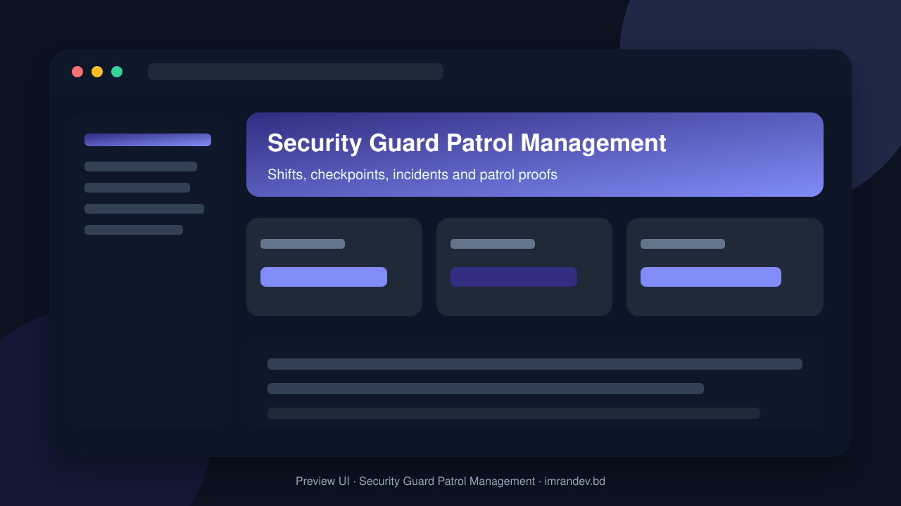
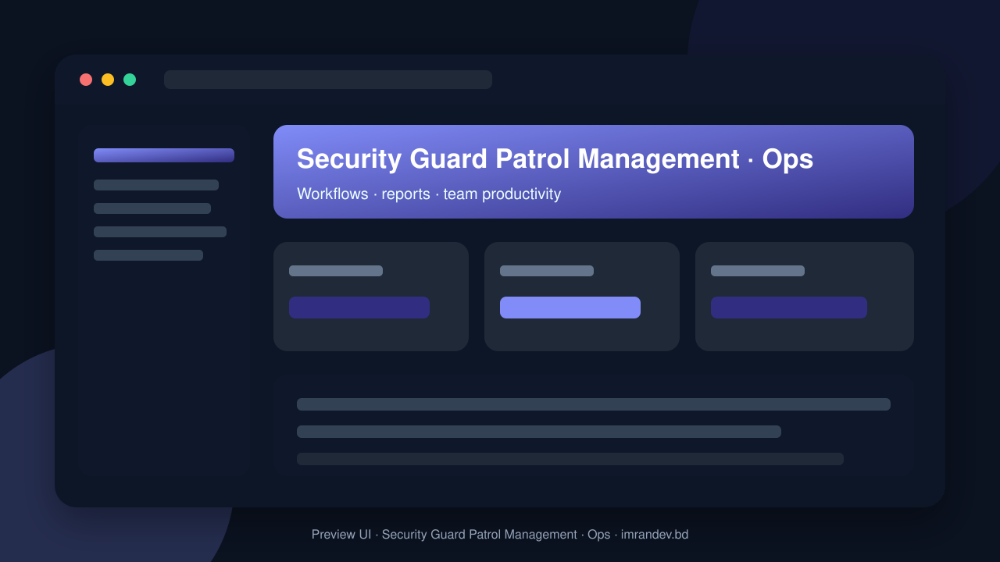

<p align="center">
  
</p>

<h1 align="center">Security Guard Patrol Management</h1>

<p align="center"><strong>Shifts, checkpoints, incidents and patrol proofs</strong></p>

<p align="center">
  <a href="https://github.com/imranbru99/security-guard-patrol-management"></a>
  
  
</p>

---

## Overview

**Security Guard Patrol Management** is a complete business application focused on real operational workflows. This README lists the full feature surface so GitHub visitors and search engines can understand every capability of the product.

## Product preview

| Dashboard | Operations |
| :---: | :---: |
|  |  |

## Complete feature list

### Application modules

- Ai Assistants
- Alarms
- Analytics
- Assets
- Attendance Tracking
- Audit Compliance
- Billing
- Catalog
- Checkpoints Tags
- Client Portal Shell
- Clients Sites
- Contracts Slas
- Control Room
- Dar
- Demo Toggle
- Discipline Performance
- Emergency
- Expenses
- Guards Employees
- Hazards
- Incidents
- Inspections
- Integrations
- Key Control
- Leads Crm
- Leave Availability
- Licences Documents
- Live Tracking
- Localisation
- Media Vault
- Microsite
- Mobile Pwa
- Module Plans
- Notifications Messaging
- Patrol Execution
- Patrol Monitoring
- Patrol Routes
- Payroll Export
- Privacy
- Public Api Webhooks
- Recruitment Ats
- Reports Dashboards
- Settings Forms
- Shift Handover
- Shift Scheduling
- Smart Scheduling
- Sos
- Tasks Post Orders
- Tenancy Organisation
- Training Certification
- Users Security
- Vehicles Gate
- Visitors

### HTTP / API controllers

- Demo Login APIs & screens
- Marketing APIs & screens
- Seo APIs & screens

### Detailed feature requirements delivered

- OPERATING RULES (read first, obey always)
- MISSION AND PRODUCT DEFINITION
- Core promise: Plan shifts → prove attendance → verify patrols at checkpoints → capture incidents with evidence → report to the client → bill and pay.
- Multi-type users: many distinct roles with separate, purpose-built interfaces (Section 5).
- Global: multi-language (LTR + RTL), multi-currency, multi-timezone, per-country labour-rule presets, PDFs in any script.
- LOCKED TECHNICAL DECISIONS
- Filament v3 (3.3.x) + Livewire 3 — the attendance-hub Filament plugin targets v3
- THE SEVEN REQUIRED PACKAGES — WHERE AND HOW EACH IS USED
- Its dashboard (/drutogoti) is reachable only by platform super admins; add a "Performance" card and deep link in the platform console.
- Install with php artisan admin-panel:install; scaffold the super-admin. Mount at /admin.
- Agentic AI inside the console: wire its AI adapters to laravel-ai-hub.
- Equipment catalog items link to the Assets module (a catalog item can be purchased into inventory) and to the Quote/Lead module (quote line items).
- Ops Copilot chat — multi-turn AIHub::chat() for managers with tool calls restricted to read-only tenant-scoped queries.
- Smart roster suggestions — explains scheduling conflicts and proposes fixes (the deterministic scheduler decides; AI only explains).
- Install migrations + config; enable tenancy (ATTENDANCE_TENANCY_ENABLED=true, resolver returns current tenant).
- Incident report (with evidence photos, timeline, signatures, QR verification code)
- Patrol tour report (route map snapshot, checkpoint timestamps, missed points)
- Duty roster / schedule (weekly & monthly), guard duty slip, post orders
- Client monthly service report (SLA, patrol compliance, incident summary)
- Schedule slug:prune daily and slug:audit weekly; add a platform console page that shows the audit.
- ARCHITECTURE — MODULAR, MULTI-TENANT, TOGGLEABLE
- Panels/ Filament panel providers: App, Guard, Client, Control
- Small guarding company (shifts, attendance, patrols, incidents, DAR)
- Industrial / factory / warehouse (gate+vehicle log, material pass, hazard reports, mustering, assets)
- USERS, ROLES AND PANELS
- MODULE CATALOGUE — BUILD EVERYTHING BELOW
- DOMAIN MODEL (minimum; extend as needed — every tenant table has tenant_id, soft deletes where sensible, ULID or UUID public IDs, indexes on tenant_id + hot columns)
- CROSS-CUTTING SYSTEMS
- Roster conflict engine: pure PHP service returning typed violations (hard vs soft), used by UI, API and auto-scheduler.
- Auto-scheduler: greedy + local-search heuristic honouring hard constraints, minimising OT cost and fairness variance; returns unfilled slots with reasons; seedable for tests.
- Missed-checkpoint evaluator: scheduled every minute per tenant with the patrols module; idempotent alert creation; grace periods; escalation timers.
- SLA scorer: nightly + on-demand per contract.
- PUBLIC WEBSITE (many public pages) AND README
- DEMO ENVIRONMENT (must work with php artisan demo:install)
- Demo users (password for all: password; show on /demo with one-click login buttons):
- QUALITY, TESTING, DEVOPS
- Coverage target: ≥ 80% on app/Core and module Services.
- Static analysis & style: Larastan + Pint in CI; composer audit and npm audit non-blocking report.
- Observability: structured logs, health endpoint /up plus detailed /health for platform admins, queue/failed-job dashboards, scheduler heartbeat.
- DELIVERY PHASES (do in order; commit after each; update PROGRESS.md)
- The work is done only when ALL are true (verify each; include evidence in docs/RELEASE_REPORT.md):
- Offline PWA flow works: airplane-mode patrol scan + incident + photo sync correctly when back online, with no duplicates.
- Public website: every page in 9.1 returns 200, passes Lighthouse/axe thresholds, has hreflang/canonical/JSON-LD; sitemap, robots, llms.txt valid.
- FIRST ACTIONS (do these now, in this order)
- Begin Phase 0. Report briefly at the end of each phase (what passed, what changed), then continue automatically to the next phase without waiting.

### Platform capabilities

- Multi-role ready structure for operators, managers and admins
- Database migrations and seeders for demo-ready local setup
- Laravel architecture with services/controllers/models separation
- Responsive UI foundation (Blade / Filament where enabled)
- Environment-based config for local and production databases
- GitHub-ready documentation with visual product previews

## Tech stack

- PHP 8.2+ / Laravel
- Filament admin resources (where enabled)
- Vite asset pipeline
- SQLite/MySQL-ready database layer
- Migrations, seeders, and test-ready structure

## Quick start

```bash
git clone https://github.com/imranbru99/security-guard-patrol-management.git
cd security-guard-patrol-management
composer install
cp .env.example .env
php artisan key:generate
php artisan migrate --seed
npm install && npm run build
php artisan serve
```

## Repository

- GitHub: https://github.com/imranbru99/security-guard-patrol-management
- Developer: **Imran Ahmed** · https://imrandev.bd

---

## 🤝 Let's Connect & Collaborate

I am open to **Senior Remote Full-Stack Roles**, AI Platform Architecture Contracts, and Enterprise Technical Advisory.

**Timezone:** UTC+6 (Dhaka / Rangpur, Bangladesh) — flexible overlap with US, UK & EU hours.  
**Delivery:** Async-ready · Slack · Discord · Jira · GitHub · production-first accountability.

| Channel | Handle | Link |
| :--- | :--- | :--- |
| Portfolio | imrandev.bd | https://imrandev.bd |
| Packagist | imrandevbd | https://packagist.org/packages/imrandevbd/ |
| LinkedIn | imranbru99 | https://linkedin.com/in/imranbru99 |
| GitHub | imranbru99 | https://github.com/imranbru99 |
| WhatsApp | +880 1576-918420 | https://wa.me/8801576918420 |
| Email | me@imrandev.bd | mailto:me@imrandev.bd |
| X | @imrandev_bd | https://x.com/imrandev_bd |
| YouTube | @ImranDevBD | https://youtube.com/@ImranDevBD |
